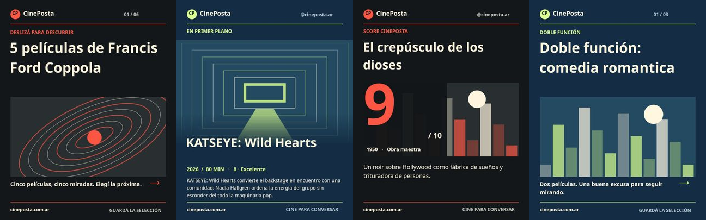
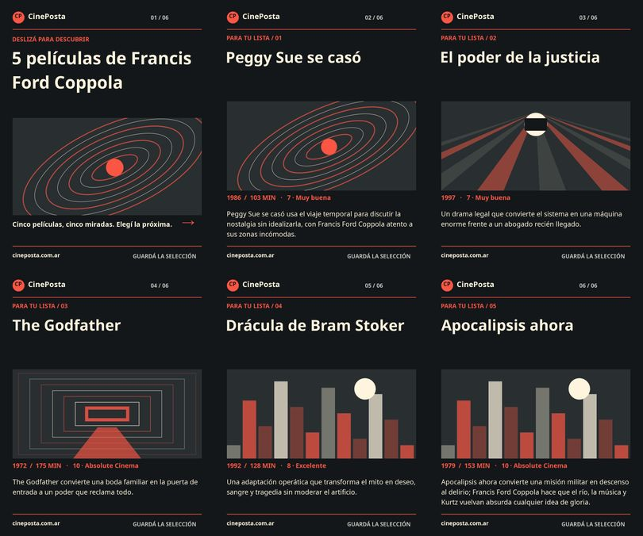

# Instagram diario: diagnóstico y rediseño · 14/11/2026

Cuenta: `@cineposta.ar`, canal Buffer `6af6465a62b70b94b0105899`, organización My organization. Horarios conservados: preparación 18:15 ART, publicación 19:15 ART. Ahora se prepara mañana para absorber demoras de GitHub. Una edición por franja, normalmente una o dos pendientes, no una cola semanal.

## Evidencia del incidente

- [Run diario de ayer](https://github.com/Clovhis/sucuplecuc/actions/runs/43540537062): disparado el 13/11 a las 22:25:48 ART, más de cuatro horas tarde; omitió una franja vencida sin consultar Buffer. El historial vacío concuerda con esa omisión. Antes los skips dejaban Actions en verde; ahora una omisión sin recibo falla y muestra el motivo.
- [Check real de Actions](https://github.com/Clovhis/sucuplecuc/actions/runs/43593537937): secret válido, profesional, conectado/desbloqueado, cola habilitada, sin recordatorios predeterminados. Dos publicaciones históricas, ninguna pendiente al comenzar. Hubo un Reel manual el 13/11: faltó la edición automática, no toda actividad del canal.
- Workflow activo y `BUFFER_INSTAGRAM_AUTOPUBLISH_ENABLED=true` comprobados. No hizo falta cambiar claves/permisos.

## Diseño y límites

Carrusel de cinco películas, protagonista, score y doble función. Selección adaptativa por catálogo/historial, temas por género/director/recorrido histórico, cuatro paletas y composiciones. Todos los integrantes se excluyen de futuras ediciones. Scores y opiniones del catálogo, sin inventar plataformas, estrenos ni valoraciones. Captions con UTM, conversación y hasta tres hashtags.

JPEG sRGB 1080×1350, tipografía mínima 28 px, menos de 8 MB. **Gráfica original** con Noto Sans SIL OFL: no se presume permiso de reutilización social de los pósters. El registro de derechos explícito permite fotografías autorizadas con evidencia, crédito y hash; actualmente está vacío. Las ilustraciones son originales y no representan fotogramas reales.

Buffer Free admite la API y carruseles automáticos profesionales; cuenta comprobada con 3 canales/10 pendientes por canal. Hasta seis imágenes por publicación. Sin nuevos servicios, dependencias, claves ni gastos. Reels/Stories existentes siguen disponibles para piezas especiales, sin condicionar la edición diaria a un teléfono.

## Validación local

24 pruebas Instagram aprobadas: calendario ART, demora real de ayer, cuatro renders con catálogo real, deduplicación de cada integrante, derechos/hashes, payload multimagen, cola, reservas, timeout ambiguo y reconciliación. Pruebas de X aprobadas, archivos de automatización X sin cambios contra la base `d3538456`. `npm run check`: 0 errores/advertencias, 3 hints preexistentes. Build local: 8915 páginas, aprobado. La skill social se sincronizó y se verificó entre repo, plugin e instalación global.

No cambió UI ni JavaScript del navegador: validación visual de JPEGs y pruebas del pipeline Node, sin suite Playwright adicional para estas placas.

Fuentes: [API/Free](https://support.buffer.com/en-us/articles/what-is-buffers-api-GtIYIQilz5), [Instagram y carruseles automáticos](https://support.buffer.com/articles/scheduling-instagram-posts-reels-stories-and-notifications-3XA98S9Q5p). El detalle operativo y la recuperación están en [buffer-instagram-automation.md](../../../docs/buffer-instagram-automation.md).
