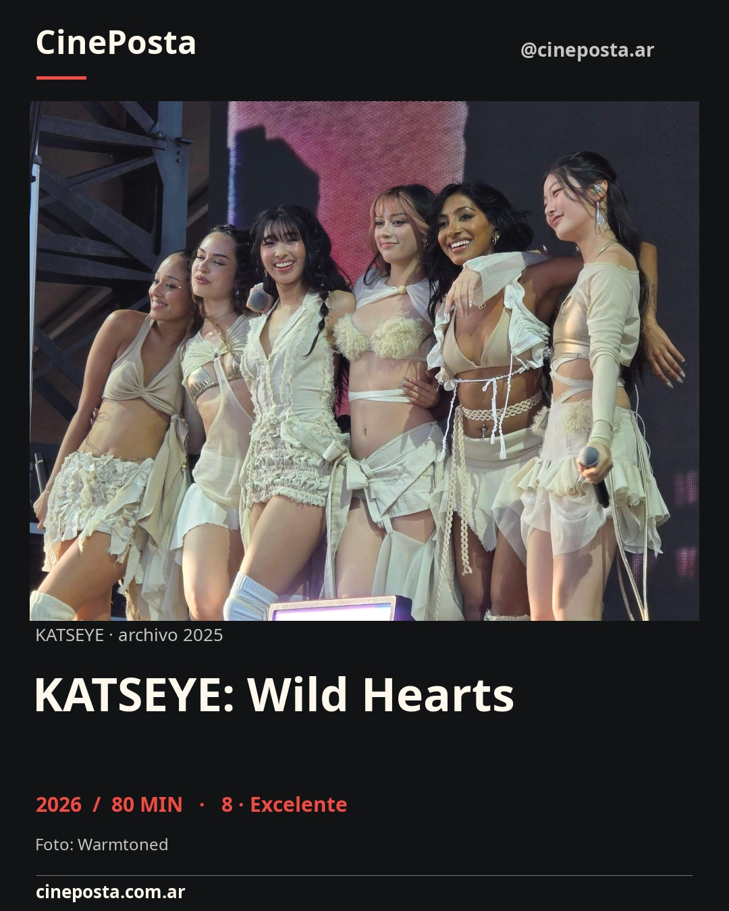
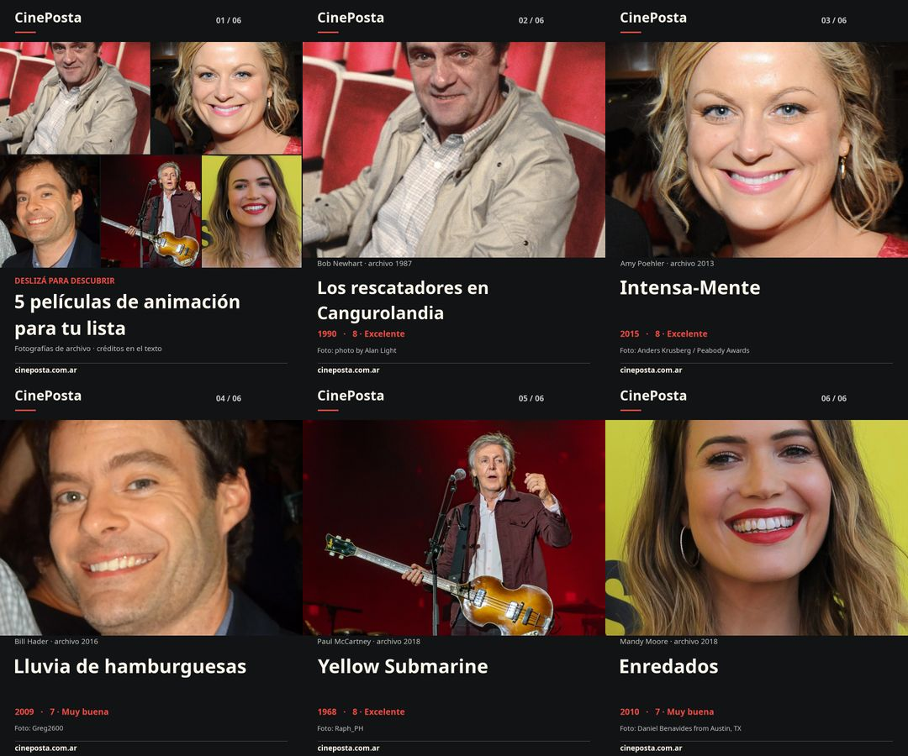
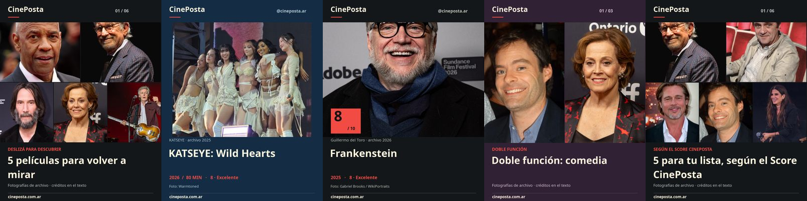

# CinePosta Instagram: fotografías reales · 14/11/2026

## Primero: las dos publicaciones existentes

Se editaron los mismos IDs mediante Buffer MCP oficial. No se creó otra publicación ni se trasladaron horarios. Recibos de edición: ambos `scheduled`, `automatic`, `customScheduled`, sin error, con imágenes 1080×1350.

| ID Buffer | Hora ART | Contenido actualizado |
| --- | --- | --- |
| `6af8537e918fe79d2e79d5ec` | 14/11/2026 19:15 | KATSEYE: Wild Hearts. Fotografía real del grupo en Wango Tango 2025, Warmtoned, CC BY 4.0. Una imagen. |
| `6af8549ac5b364e062edcec2` | 15/11/2026 19:15 | Misma selección de cinco animadas, portada fotográfica + cinco placas con retratos de archivo de Bob Newhart, Amy Poehler, Bill Hader, Paul McCartney y Mandy Moore. Seis imágenes. |

Los retratos se identifican como **archivo + año**. No son fotogramas ni pósters de las películas. El texto conserva la selección, años, scores y URLs, y agrega créditos, títulos de las fotos, fuentes, licencias y cambios. Los captions finales tienen 740 y 1605 caracteres. La atribución de Amy Poehler incluye Anders Krusberg / Peabody Awards.

Medios finales públicos verificados por HTTP y SHA-256, fijados al commit `c1d2ea5fed198eeb17dde8f52e6dc4660b465677` de `cineposta-instagram-state`. La rama conserva los recibos y las versiones anteriores en `mediaRevisions`; registro final de atribución en `4f3ceeea`. No se borró ni reinició el historial y no se alteraron las publicaciones manuales anteriores.

Buffer rechazó el intento de editar sólo texto porque exige imagen y tipo de Instagram; se usó después el payload completo con los mismos assets, metadatos y horario. Los recibos finales verifican la actualización. No se reintentó una creación ni se consumieron posiciones adicionales de cola.

## Sistema para las siguientes ediciones

El generador exige imágenes reales en cada página: carrusel, protagonista, score, doble función y ranking. Las imágenes ocupan el área principal; marca, score y datos las acompañan. Pósters completos, recortes sólo cuando se permite, scores superpuestos sólo con permiso. Cinco formatos, paletas editoriales, prioridad de imágenes menos usadas, selección por género/director e historial, y ranking por scores existentes.

Se eliminó la función de ilustraciones abstractas. Una película sin foto autorizada queda fuera; si no hay ninguna, el job falla sin producir contenido genérico. También se bloquea el envío nuevo de una reserva abstracta antigua. Se conserva la reconciliación de los posts ya existentes.

Registro v2: **16 fotografías aprobadas**, capaces de acompañar **145 películas elegibles** del catálogo actual por vinculación exacta con `mainCast`/`director` o por slugs explícitos. No es una autorización de todos los archivos de `public/people/` ni de `public/assets/posters/`. Los originales de baja resolución se reemplazaron por copias mayores del mismo archivo autorizado; el catálogo de personas no se modificó.

Se conserva licencia, fotógrafo, título, fuente, revisión de evidencia, hashes, fecha de foto/verificación, territorio, embargo/vencimiento y permiso para Instagram orgánico/alojamiento público. El cron usa el registro local, sin APIs de IA, costos nuevos ni consulta diaria de licencias. Las adaptaciones con SA se distribuyen bajo CC BY-SA 4.0 y conservan las licencias originales de las fotos.

## TMDB y prensa: alcance comprobado

La integración existente fue probada con KATSEYE: ID `1728113`, 22 pósters/backdrops y ocho retratos localizados. El nuevo comando `social:images:discover` los guarda **pending-rights**, sin descargarlos ni aprobarlos para publicar. Usa la clave local existente, sin imprimirla ni modificarla.

**No se obtuvo permiso de los estudios para usar los afiches o fotogramas de estas seis películas.** El registro guarda esos candidatos como pendientes. Disney+ Press ofrece material oficial y contacto, pero falta acreditar alcance de adaptación y alojamiento público para Instagram orgánico en Argentina. No se presenta acceso a TMDB o a un press kit como permiso universal. No se enviaron correos ni se abrieron cuentas/acreditaciones.

Para incorporar ese material hace falta una política aplicable o autorización del titular que cubra tipo de publicación, territorio, plazo, recorte/textos, crédito y alojamiento público que requiere Buffer. La infraestructura admite ese permiso reutilizable como `press-permission`, con titular y alcance documentados. Contacto publicado del paquete KATSEYE: `Disney+.Media.Relations@disney.com`.

## Validación y operación

- 27 pruebas Instagram: imágenes obligatorias, permisos pendientes/vencidos/restringidos, hash alterado, cron demorado, cinco formatos con fotos, deduplicación de todos los integrantes, timeout ambiguo, recibos y bloqueo de reservas abstractas.
- Pruebas de X aprobadas; scripts, workflow, historial, variables y secret de X sin cambios.
- `npm run check`: 0 errores, 0 advertencias, 3 hints preexistentes.
- Build local y controles de publicación obligatorios; la validación remota de fotografías se registra al completar el handoff.
- No cambia UI ni JavaScript del navegador: se verificaron los JPEGs visualmente, no se añadió una suite Playwright para gráficos generados en Node.
- Skills verificadas iguales entre repositorio, plugin e instalación global.

Horarios conservados: preparación **18:15 ART**, edición de mañana, publicación **19:15 ART**. Actions, Buffer Free, ramas operativas, concurrencia, hashes públicos y protecciones contra duplicados se mantienen. Las dos ediciones ya están programadas, no se informan como publicadas.

Todas las composiciones con ShareAlike y las galerías de este informe se ofrecen bajo [CC BY-SA 4.0](https://creativecommons.org/licenses/by-sa/4.0/), conservando los derechos/licencias originales de las fotografías. Créditos completos, títulos y fuentes individuales en el [registro de imágenes](../../../assets/social/instagram-rights.json) y sus evidencias. Montaje, recorte y tipografía: CinePosta; Noto Sans bajo SIL OFL.

Guía operativa: [instagram-image-rights.md](../../../docs/instagram-image-rights.md). Fuentes primarias: [TMDB FAQ](https://developer.themoviedb.org/docs/faq), [foto KATSEYE](https://commons.wikimedia.org/wiki/File:Katseye_at_Wango_Tango_2025.jpg), [CC BY 4.0](https://creativecommons.org/licenses/by/4.0/), [BY-SA 2.0, cláusula 4.b](https://creativecommons.org/licenses/by-sa/2.0/legalcode.en), [Disney+ Press](https://press.disneyplus.com/news/katseye-wild-hearts-on-disneyplus-hulu).
